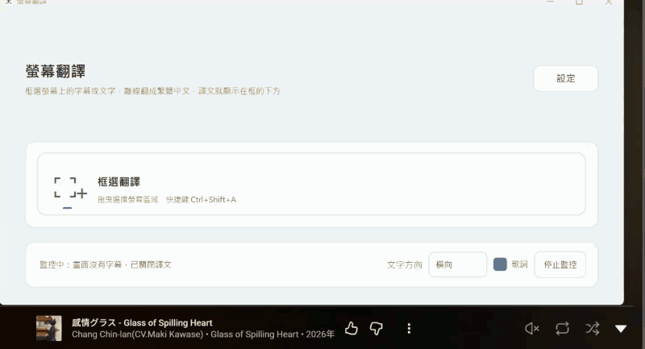
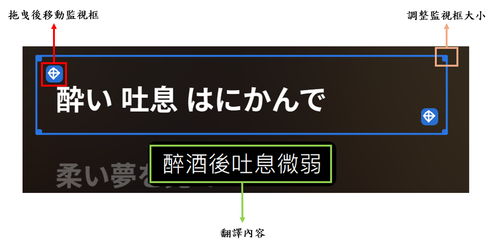

# 螢幕截圖翻譯（ScreenTranslator）

Windows 桌面上的即時字幕翻譯工具：在畫面上框一塊區域，程式偵測到字幕變化就辨識文字，翻成**繁體中文**（台灣用語；目標語言固定只有繁體中文，不提供其他選項）顯示在框的下方，並把原文、譯文與座標寫進文字檔。辨識與翻譯**全部在本機離線完成**，不需要網路、不需要金鑰（安裝時下載翻譯模型除外）。

- **來源語言**：日文、英文。預設是橫排文字；日文直書（由上往下讀、欄由右往左）要在主視窗把「文字方向」改成「直向」。
- **適合**：影片與直播字幕、歌詞、遊戲對白、無法複製文字的軟體畫面。

## 示範

實機操作的示範（約 1 分鐘，從框選字幕、譯文出現，到移動與調整監視框）：



框選字幕之後，框會留在畫面上，譯文顯示在框的下方：



## 這個專案的目的

這是上游專案 [xuange-hu/screen-translator](https://github.com/xuange-hu/screen-translator) 的分支（fork）。上游是「截圖 → 辨識 → 線上翻譯 → 疊加譯文」的通用截圖翻譯工具；這個分支把它改成**打遊戲、看影片、聽歌時的即時字幕翻譯**，主要做了三件事：

**1. 優化監視功能**（框住字幕區域，持續翻譯）

- 變化偵測改成逐像素指紋：字幕沒變、畫面靜止時跳過整輪辨識與翻譯，CPU 用量低；影片背景一直在動時也不誤觸發。
- 字幕穩定化：可設定要連續辨識到幾次相同結果才翻譯，避免字幕淡入淡出時把殘缺的句子翻成怪句子；內容和已顯示的相同就不重翻。
- 辨識間隔最短 0.1 秒；字幕消失一秒後自動關閉譯文；停止監控時一併清掉譯文。
- 譯文放在框的下方（放不下改放上方）、監控框常駐在畫面上（中間透明、用角落的符號拖曳移動、拖邊框縮放）；滑鼠離開框超過 2 秒，框會變淡免得擋住畫面，移回來就恢復；程式自己的視窗不會被擷取回去辨識。
- 換翻譯模型存檔後立刻在背景載入並顯示「模型更換中」，載入期間監控先不送翻譯，載完自動繼續；停止監控超過 10 秒會把模型從記憶體放掉，下次用到再自動載回。

**2. 新增離線翻譯模型**

- 用 llama.cpp 執行 Qwen2.5／Qwen3 的 GGUF 模型（1.5B 到 7B，預設 3B），翻成繁體中文並轉成台灣用語（OpenCC）；CPU 就能用，有顯示卡（含內顯）時可選用 Vulkan 版減輕 CPU 負擔。
- 為這些小模型調整的功能：上下文（前兩句）、歌詞模式、略過擬聲詞、生成時擋掉外文、針對 Qwen2.5 的中文提示詞、譯文後處理；提示詞調整的過程與數字見 [PROMPT_TUNING.md](PROMPT_TUNING.md)。
- 設定頁可選模型，並有「測試速度」；各模型的速度與品質比較見 [MODEL_COMPARISON.md](MODEL_COMPARISON.md)。

**3. 其他**

- 主視窗精簡成「框選翻譯」「即時監控」「設定」三個入口。
- 辨識引擎預設改用 RapidOCR（PP-OCRv6，離線，一個模型涵蓋日文、英文、中文），Windows 內建 OCR 仍可選用。
- 文字輸出：每句字幕結束時寫一行（時間、原文、譯文、模型、四角點座標）。
- Windows 安裝程式：安裝時勾選要下載哪些翻譯模型（推薦 3B），下載後驗證 SHA-256。
- 移除了和這個目標無關的部分：會連到第三方下載並執行程式碼的自動更新器與 PaddleOCR 元件下載器、上游的發佈流程，以及**所有線上翻譯服務與金鑰設定**（翻譯只剩離線模型，目標語言固定繁體中文）。

## 程式碼來源

| 部分 | 來源 |
|---|---|
| **上游程式碼** | [xuange-hu/screen-translator](https://github.com/xuange-hu/screen-translator)，MIT 授權，Copyright (c) 2026 ScreenTranslator contributors；本分支從它的 commit `e2f7865`（2026-10-10）出發，2026-10-12 匯入（本專案的 commit `8be289b` 只是原樣匯入，沒有其他修改）。保留並沿用的有：截圖與座標（mss、DPI、多螢幕）、框選與覆蓋層介面、系統匣與快捷鍵、設定介面的骨架、翻譯器的共同介面與快取、Windows OCR 引擎、測試框架 |
| **本分支新增的程式** | `services/ocr/rapidocr_ocr.py`（RapidOCR）、`services/translation/` 下的 `offline_translator.py`、`offline_common.py`、`llama_backend.py`、`token_filter.py`、`model_names.py`、`speed_test.py`（離線翻譯）、`services/transcript*.py` 與 `app/transcript_mixin.py`（文字輸出）、`app/model_loading_mixin.py`（模型載入提示）、`utils/stability.py`（字幕穩定化）、`utils/chinese.py`（繁體與後處理）、`utils/window_affinity.py`、`ui/translation_panel.py`、`scripts/`、`installer/`、`ScreenTranslator.spec`，以及 30 多個新增的測試檔 |
| **本分支大幅修改的上游檔案** | `ui/settings_dialog.py`、`app/monitor_mixin.py`、`app/config.py`、`app/settings_mixin.py`、`app/pipeline_mixin.py`、`app/capture_mixin.py`、`workers/translation_worker.py`、`ui/overlay_manager.py`、`ui/main_window.py`、`utils/layout_utils.py`、`utils/language_utils.py` |
| **移除的上游部分** | 自動更新器、PaddleOCR 元件下載器、Authenticode 驗證、**所有線上翻譯服務與它們的金鑰設定**（Google、DeepL、OpenAI 相容、百度、有道、Azure、MyMemory）、上游的發佈流程與社群檔案，詳見 [UPSTREAM.md](UPSTREAM.md) |
| **第三方元件與模型** | PySide6、onnxruntime、RapidOCR（PP-OCR 模型）、llama.cpp、OpenCC 等；翻譯模型是 Alibaba Cloud 的 Qwen（官方 GGUF，不經轉換）。授權逐項列在 [THIRD_PARTY_LICENSES.md](THIRD_PARTY_LICENSES.md) |
| **開發方式** | 本分支的修改由專案作者與 Claude Code（Anthropic）協作完成，提交紀錄的 `Co-Authored-By` 有標註 |

想看這個分支相對上游改了什麼：`git diff 8be289b HEAD`（`8be289b` 是原樣匯入的上游版本）。

## 下載與安裝

**下載**：到 [Releases 頁面](https://github.com/haha20331/screen-translator-zh/releases) 下載最新版的 `ScreenTranslator-<版本>-Setup.exe`（約 125 MB，翻譯模型不在裡面，安裝時才下載）。同一頁還有一個 `.sha256` 檔，可以用來核對下載的檔案（見下面）。

**系統需求**：Windows 10（1809 以上）或 Windows 11，64 位元；記憶體建議 8 GB 以上（預設的 3B 模型載入後約佔 3.6 GB）；磁碟空間：程式約 380 MB，加上你選的模型。不需要顯示卡，不需要另外安裝 Python 或其他執行環境。

### 安裝步驟

1. 雙擊下載的 `ScreenTranslator-<版本>-Setup.exe`。Windows 若顯示「Windows 已保護您的電腦」，按「**其他資訊**」→「**仍要執行**」（安裝程式沒有程式碼簽章，下面有說明）。
2. 勾選同意授權合約後按「下一步」。安裝資料夾預設在你的使用者資料夾底下（`%LOCALAPPDATA%\Programs\ScreenTranslator`），不需要系統管理員權限，不想改就直接下一步。
3. 在「**選擇元件**」頁選要裝什麼：
   - **建議安裝**（預設）：程式加 Qwen2.5 3B 翻譯模型（約 2.1 GB，需要網路）。
   - **只安裝程式**：不下載模型，之後自己補（見下面）。
   - **自訂**：自己勾選要下載哪些模型，可以多選。
   勾了 3B 時，安裝程式會多跳出一個確認視窗，按「是」才會繼續下載。
4. 「選擇附加工作」頁可以勾選建立桌面捷徑，再按「下一步」、「安裝」。安裝程式會下載你勾選的模型並驗證檔案是否正確（網路慢時要等一陣子，驗證不過會整個取消安裝，不會留下半套檔案）。
5. 安裝完成，勾著「啟動 Screen Translator」按「完成」就會開啟程式。以後從開始功能表的「Screen Translator」開啟。

### 第一次使用

1. 主視窗很簡單：**框選翻譯**（大卡片，上面寫著快捷鍵）、**即時監控**、**設定**。第一次啟動會有三頁簡短的歡迎說明，同時程式會在背景載入翻譯模型，狀態列顯示「正在載入翻譯模型…」，約 10～30 秒，載完會顯示「翻譯模型已就緒」。
   程式也有一個**系統匣**圖示（螢幕右下角、工作列右邊的小圖示），按右鍵可以快速操作或退出。預設按主視窗右上角的關閉鈕就會結束程式；想讓它關掉視窗後繼續在背景執行，到「設定 → 一般」勾選「關閉主視窗時最小化到托盤」（點圖示可以再打開視窗）。另一個選項「最小化主視窗時收到托盤」預設不勾，最小化會縮到工作列。
2. 把要翻譯的畫面（影片、遊戲、歌詞…）開在螢幕上，按 **`Ctrl+Shift+A`**（或按主視窗的「框選翻譯」），用滑鼠拖出一個框住字幕區域的矩形。文字是直排的話（日文直書），先把主視窗的「文字方向」改成「直向」再框選。
3. 譯文會出現在框的下方，之後程式自動進入**即時監控**：字幕換了就自動重翻。按 **`Ctrl+Shift+M`** 可以開關監控。
4. 原文、譯文與座標會存進 `%LOCALAPPDATA%\ScreenTranslator\output\<日期>.txt`，系統匣選單的「開啟輸出資料夾」可以直接打開。
5. 在「設定 → 翻譯」可以換模型、選用 CPU 或顯示卡、用「測試速度」比較各模型在你的電腦上跑多快；輸入語言和辨識引擎（OCR）也在設定裡。更多操作見下面的[使用](#使用)。

**可以下載的翻譯模型**（安裝時在「選擇元件」頁勾選，需要網路，下載後會自動檢查檔案有沒有損壞；預設勾選**推薦**的 Qwen2.5 3B）。名字裡的 1.5B、3B、4B、7B 是模型的大小：**數字越大，翻得越準，但也越慢、越吃記憶體**。一般電腦用 3B 就好；電腦比較慢就換 1.5B。

| 模型 | 大小 | 說明 |
|---|---|---|
| **Qwen2.5 3B（推薦）** | 約 2.1 GB | 翻得準、速度也不慢，一般電腦夠用，預設用這個 |
| Qwen2.5 1.5B | 約 1.9 GB | 最小最快，翻得還可以；電腦比較慢時用，沒有 3B 時程式會自動改用它 |
| Qwen3 4B | 約 2.5 GB | 比 3B 再大一點，更準但更慢 |
| Qwen2.5 7B | 約 4.7 GB | 最準，但很慢，要約 6 GB 可用記憶體，有獨立顯示卡時才建議用 |

不確定哪個適合你的電腦，到「設定 → 翻譯」按「測試速度」，會量每個已下載的模型翻一句要多久。各模型的速度與品質比較見 [MODEL_COMPARISON.md](MODEL_COMPARISON.md)。之後想補下載其他模型，重新執行安裝程式勾選即可（已經裝好的模型不會被刪）。

**自己放模型**也可以：「設定 → 翻譯 → 模型路徑」會寫出放模型的資料夾的完整路徑（沒有任何模型時也會寫）。每個模型一個子資料夾、裡面放 `.gguf` 檔，例如安裝資料夾的 `models\translation\<模型名稱>\`；放進去後按「重新掃描」，它就會出現在「離線翻譯模型」選單的最後面（「自訂：…」）。用「選擇其他資料夾…」可以指定自己的資料夾。自訂的模型請用 Qwen 系列的 GGUF 檔，其他種類的模型可能翻不好。

**關於「Windows 已保護您的電腦」**：目前的安裝程式沒有程式碼簽章，SmartScreen 可能顯示警告，按「其他資訊 → 仍要執行」。Release 頁面的說明文字和 `.sha256` 檔都有安裝程式的 SHA-256，可以用 PowerShell 核對下載的檔案有沒有損壞或被換過（在放安裝程式的資料夾裡執行）：

```powershell
(Get-FileHash -Algorithm SHA256 .\ScreenTranslator-0.3.0-beta-Setup.exe).Hash.ToLower()
Get-Content .\ScreenTranslator-0.3.0-beta-Setup.exe.sha256     # 兩個要完全一樣
```

**解除安裝**：從「設定 → 應用程式」移除。安裝程式下載的模型會一起移除；你的設定、翻譯快取與輸出的文字檔在 `%LOCALAPPDATA%\ScreenTranslator\`，不會被刪。

## 使用

| 快捷鍵 | 動作 |
|---|---|
| `Ctrl+Shift+A` | 框選一塊區域並翻譯，之後自動進入即時監控 |
| `Ctrl+Shift+M` | 開／關即時監控 |
| `Ctrl+Shift+F` | 翻譯整個螢幕 |
| `Ctrl+Shift+W` | 翻譯目前視窗 |
| `Ctrl+Shift+H` | 顯示／隱藏譯文 |
| `Ctrl+Shift+R` | 重新辨識、重新翻譯 |

快捷鍵可以在「設定 → 快捷鍵」修改。主視窗上只放了「框選翻譯」和「即時監控」；翻譯整個螢幕、翻譯目前視窗用快捷鍵，或在系統匣圖示上按右鍵選。

**文字方向**：主視窗的「文字方向」選「橫向」（預設）或「直向」，決定這次要翻的文字怎麼讀。直向會把每一欄當成一行，欄由右往左讀，相鄰的欄併成一段再翻譯；即時監控中也可以直接改，下一輪就照新的方向辨識。只在這次執行有效，下次啟動又是橫向。直向要用 rapidocr 辨識引擎（預設就是），Windows 內建 OCR 不支援，程式會自動改用 rapidocr。譯文放在「顯示在框下方」時，直向的譯文由右到左一欄一行列在面板裡；選「蓋在原文上方」（「設定 → 譯文顯示 → 譯文位置」）時，譯文的排列方向跟著文字方向，直向就由上往下、欄由右往左排在原文的位置上（逗號句號置中，括號與破折號轉 90 度）。

**即時監控**：框選之後，框會留在畫面上（即使框得太小、或框內暫時沒有文字，也一定會建出框，再慢慢調整）。框的中間是透明的，可以直接點到後面的畫面；按住框左上或右下角的移動符號拖曳來移動（滑鼠離開框，符號就隱形，移回來才出現），拖邊框與四個角縮放。不想用符號的話，「設定 → 即時監控 → 監視框的移動方式」可以改成「拖曳框的中央」：整個框都能拖，代價是框的中間不再點得到後面的畫面；滑鼠離開框超過 2 秒，框會變淡，移回來就恢復。字幕出現、改變時才辨識並翻譯；畫面沒變就不動作。預設辨識到就顯示（最快）；字幕淡入淡出時若會先閃出殘缺的句子，可以在「設定 → 監控」把確認次數調成 2（要連續辨識到相同結果才顯示，換字幕約慢半秒到一秒），間隔與「字幕消失多久後關閉譯文」（預設 1 秒）也在那裡。

**翻譯設定**（「設定 → 翻譯」）：

- **輸入語言**：自動偵測，或指定日文、英文等；目標語言固定是繁體中文。
- **離線翻譯模型**：選用哪個模型；「測試速度」會量每個已下載模型在這台電腦上的速度。換模型存檔後，程式會馬上在背景載入並顯示「模型更換中」。
- **運算裝置**：用 CPU，或用顯示卡（含內顯）來翻譯，可以指定哪一顆；「重新偵測」會列出這台電腦有哪些顯示卡。
- **停止監控後釋放模型**（「設定 → 一般」）：停止即時監控超過 10 秒，就把翻譯模型從記憶體放掉（3B 約 2.8 GB），下次框選或開始監控時自動載回來（要幾秒到十幾秒）。設成 0 就一直留在記憶體裡。
- **使用上下文**（預設開，兩句）：把前面翻好的句子當作前文，讓代名詞與語氣前後一致。
- **歌詞模式**：看的是歌詞時打開，改用適合歌詞的提示與示範。
- **略過擬聲詞**（預設開）：只有音效、笑聲、吶喊的字幕不翻譯。
- **避免譯文夾雜外文**：譯文夾雜假名或外文時，在生成當下擋掉並重翻。

**移動或調整監視框時先不翻譯**：拖曳、調整大小的期間，框會掃過別的文字，程式不辨識也不翻譯；放開之後再等 1 秒才繼續（「設定 → 即時監控 → 移動或調整監視框後等待」可以改秒數，0 = 不等待）。

**文字輸出**：每句字幕結束時寫一行到 `%LOCALAPPDATA%\ScreenTranslator\output\<日期>.txt`（UTF-8、欄位以 Tab 分隔）：開始與結束時間、原文、譯文、狀態、使用的模型、四個角點的螢幕座標。系統匣選單的「開啟輸出資料夾」可以直接打開。

## 隱私

- 辨識與翻譯都在本機；使用離線翻譯時，不會有任何文字或截圖離開你的電腦。
- 預設不儲存截圖與辨識歷史。
- 程式的記錄檔只記狀態，不記錄辨識到的文字、截圖或金鑰。
- 程式**沒有任何線上翻譯服務**（上游的 Google、DeepL、OpenAI 相容等都已移除），也不儲存任何服務的帳號或金鑰；舊版設定檔裡殘留的服務設定與金鑰，程式一啟動就會刪掉並存回檔案。辨識到的文字不會送到任何地方。
- 只有安裝時下載翻譯模型會連網（連到 Hugging Face）。

## 從原始碼執行、建置安裝程式

- 開發環境、測試與模型下載：[DEVELOPMENT.md](DEVELOPMENT.md)。
- 打包成安裝程式：[PACKAGING.md](PACKAGING.md)。
- 設計與開發紀錄：[PLAN.md](PLAN.md)；提示詞調整的過程與數字：[PROMPT_TUNING.md](PROMPT_TUNING.md)。
- 只在 CPU 上跑就夠用；有顯示卡（含內顯）時可以用 GPU 減輕 CPU 負擔。安裝版同時附 CPU 版與 GPU 版（Vulkan）的 llama.cpp，啟動時自動選（這台電腦沒有 Vulkan 就用 CPU 版）；設定 → 翻譯 →「運算裝置」可以隨時選用 CPU、自動、或指定哪一顆 GPU，不必重裝，那裡也會列出這台電腦有哪些顯示卡。從原始碼執行的話，GPU 版要自己裝，見 `requirements-vulkan.txt`。

## 授權

程式本身採 [MIT](LICENSE)：上游的著作權聲明（Copyright (c) 2026 ScreenTranslator contributors）必須保留，本分支的修改同樣以 MIT 釋出。
第三方元件與模型的授權見 [THIRD_PARTY_LICENSES.md](THIRD_PARTY_LICENSES.md)（安裝後也在安裝資料夾的 `licenses\` 裡）；**Qwen2.5 3B 的授權（Qwen Research License）限非商用**，其餘模型是 Apache-2.0。
